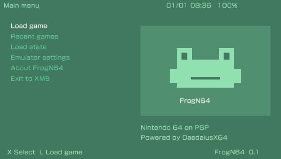

# FrogN64

Emulador de Nintendo 64 para PSP, baseado no núcleo atual do
[DaedalusX64](https://github.com/DaedalusX64/daedalus), com interface adaptada do
[FrogGBA](https://github.com/tzubertowski/FrogGBA).

O fork é mantido em [jussimir/FrogN64](https://github.com/jussimir/FrogN64), na
branch `psp-development`. A base inicial do núcleo é o commit upstream
`580c0c409358db332149fc2903c610449434f8fc`, de **10/10/2026**.

A interface PSP tem o fundo verde e seleção creme do FrogGBA, menu vertical,
navegador de ROMs em duas colunas, jogos recentes, relógio/bateria e menu de
pausa. As opções de emulação, controles, cheats e savestates usam o código do
DaedalusX64. A fila de áudio recebeu correções cobertas por testes sintéticos.
O renderizador PSP corrige torsos de LEGO Racers e o recorte vertical das prévias;
veja as [comparações gráficas](docs/LEGO-RACERS.md).
O [GoldenEye](docs/GOLDENEYE.md) usa ROM em RAM nos modelos compatíveis para
reduzir a demora após a intro. O carregamento tem o visual Frog e barra de progresso.
Não há ganho de FPS medido.



```sh
./scripts/psp.sh
```

O ZIP `dist/FrogN64-PSP-<commit>.zip` contém `PSP/GAME/FrogN64/`. Copie essa pasta
para o cartão e coloque suas ROMs em `FrogN64/Roms/`, ou navegue até a pasta em
que elas já estão. A instalação pode coexistir com DaedalusX64 e FrogGBA.
O pacote solicita RAM ampliada nos modelos compatíveis (`MEMSIZE=1`).

Veja o [guia PSP](docs/PSP.md), o [guia da interface](docs/FROGN64-UI.md) e o
[guia PSPLink](docs/PSPLINK.md), além do [ambiente headless](docs/HEADLESS.md).
Software livre, GPL v2 ou posterior; créditos originais preservados, com [atribuição do FrogGBA](Data/licenses/FrogN64-UI.txt).

## Documentação original do núcleo DaedalusX64

DaedalusX64 is a Nintendo 64 emulator for PSP, 3DS, Vita, Linux, macOS and Windows
 
## Features:
 
- Fast emulation
- High compatibility
- Support for PSP / 3DS / macOS / Linux / Windows
- Active support and updates

## Things that don't work right now:
- Big Endian (So no builds for PowerPC at the moment sorry).
 
## Usage
 
Installing Daedalus:
Download the latest release for your platform from https://github.com/DaedalusX64/daedalus/releases or if you dare, use the latest builds in the GitHub Action section

Extra Steps:
PSP: Copy the entire DaedalusX64 Folder to your Memory Stick and put into PSP/Game

macOS / Linux:
 Prerequisites: libpng / zlib / minizip / glew / SDL2 (You'll need to do this via a package manager.
 Execute the emulator ./daedalus 'Path to Rom' 
Note - Native Apple Silicon build via GitHub is not available yet however it compiles fine and works (Just a bit slow as expected)
## Building
All Versions require these libraries: zlib, libpng, minizip
 ## Building for PSP
    Fetch the latest PSP Toolchain from https://github.com/pspdev/pspdev and install required libraries
    
    Run    ./build_daedalus.sh PSP and CMake will do the required fun stuff :)

## Building for Windows 

NB: Windows build is broken at the moment 

1) Clone and open the repo in Visual studio 2019

2) Build All

## Building for Posix OS (Linux & macOS)
Posix OSes additionally require glew / SDL2

1) Clone this repo 

2) ./build_daedalus.sh (This will auto detect the OS you are on)
 
 ## CI
 DaedalusX64 now has CI, you can get the latest nightlies from the Actions Tab.
 Warning: these builds are sporatic at times.

## More Info
 
For information about compatibility, optimal settings and more about the emulator, visit the actively maintained GitHub wiki page: https://github.com/DaedalusX64/daedalus/wiki Feel free to submit reports for how well your favourite games run if they have not already been listed!
 
We're on Discord, come catch up with the latest news. Chaos ensured. https://discord.gg/FrVTpBV
 
## Credits
- StrmnNrmn - For bringing this project to us
- Kreationz, Howard0Su salvy, Corn, Chilly Willy, Azimer, Shinydude100 and missed folks for past contributions
- MasterFeizz for 3DS Support / ARM DynaRec
- Xerpi / Rinnegatamante / TheOfficialFloW for PS Vita and ARM Contributions
- z2442 & Wally: Compilation improvements and updating, optimizations
- TheMrIron2 & mrneo240 Optimizations, wiki maintenance
- re4thewin for continuous testing over the duration of DaedalusX64
- motolegacy for help with site and emulator itself
- fjtrujy for help with getting CI going.
- Our Valued Communities for helping making Daedalus what it is :)
