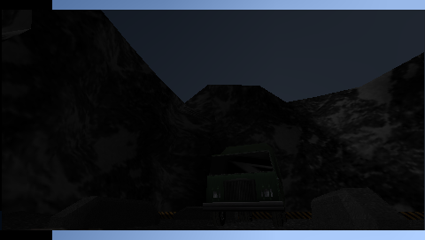
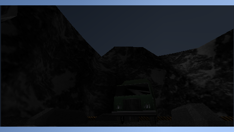

# GoldenEye 007 — abertura e primeira missão

## Problema reproduzido em 17/10/2026

No PSP, o usuário relatou quase um minuto de tela preta após a intro. A tela
Select File apareceu depois, sem travamento permanente. O PSPLink confirmou
`No exception occurred`. A sessão física foi encerrada e o aparelho liberado
para outro projeto; a investigação seguinte usa somente PPSSPPHeadless.

A ROM do cartão e a cópia local foram comparadas byte a byte por SHA-256:
`33d4609661bd207d22146463e64edbcc5cc9a21668f4f8e450642d2a2f6d2de8`,
12 MiB, ID Daedalus `d150bcdca31afd09-45`, GoldenEye 007 (U) [!]. Não é
incluída no repositório ou no pacote.

A build `6ac6136` e a anterior `4b19f1e` mostraram o mesmo intervalo escuro de
aproximadamente 40 segundos no primeiro roteiro. Logo, as correções recentes
de projeção e recorte do LEGO não introduziram a demora.

## Correção

GoldenEye acessa código da ROM pelo mapeamento TLB `0x7f`. O atalho herdado em
`Memory_Tlb_Hack` só é instalado quando a ROM tem endereço fixo. O padrão
File Cache mantinha esse caminho indisponível, com acesso mais caro durante
a emulação. A comparação controlada com ROM inteira em RAM apontou uma melhora
grande antes de alterar o núcleo.

A build agora prefere um buffer fixo para o cartucho GE de 12 MiB nos PSPs
com RAM ampliada. Usa o heap de ROM de 16 MiB já reservado, sem aumentar sua
reserva total. Se a alocação falhar, volta ao cache de arquivo. PSP-1000 e
imagens de outros tamanhos continuam com a política anterior. O caso validado
é a ROM americana acima; não é uma certificação das demais revisões ou hacks.

O carregamento também passa a falhar se uma leitura de bloco não terminar,
em vez de iniciar uma ROM parcialmente lida. Os demais jogos mantêm a escolha
de cache/buffer das preferências.

## Evidências sintéticas

O roteiro `tests/headless/goldeneye-dam.json` reconhece a inscrição Select File
por comparação de imagem antes de enviar os próximos comandos. Confere o
buffer fixo no log, seleciona uma partida e alcança Dam em primeira pessoa.
Também envia movimento e salva capturas antes/depois.

Na build final, Select File foi reconhecido 33,3 segundos após iniciar o EBOOT,
incluindo a navegação Frog e a intro, com dois comandos Start. O maior trecho
escuro amostrado durante a transição foi de 1,5 segundo, com amostras a cada
0,5 segundo. A espera por imagem começou logo após o segundo Start e durou
22,5 segundos; esse período também inclui animação visível da intro.

A build anterior recebeu os mesmos inputs e não encontrou Select File até
125,6 segundos desde o boot (100 segundos na espera por imagem, iniciada após
um intervalo fixo de 15 segundos). O maior trecho escuro observado nessa janela
foi de 28 segundos. Este roteiro tem inputs diferentes do primeiro experimento
de 40 segundos; não misturar essas medidas.

O tempo é medido no relógio do PSP emulado a 333 MHz, não em FPS N64 nem em
segundos medidos no aparelho. Transições curtas escuras do jogo continuam:
a correção não oculta o framebuffer com uma tela de carregamento durante a
partida. Audio Disabled foi usado para isolar a abertura; o áudio e a cadência
física não são aprovados por esse teste.

Também foi exercitado o fallback com uma cópia local sintética ampliada para
32 MiB: a tentativa não cabe no heap de ROM, o log confirma File Cache e a
execução continua. Isso verifica o tratamento de alocação, não compatibilidade
com uma ROM modificada.

Evidências locais: `dist/headless/goldeneye-verified-dam/`,
`dist/headless/goldeneye-measured-baseline/`, `dist/headless/goldeneye-final-gate/`
e `dist/headless/loader-allocation-fallback/`.

## Confirmação física da abertura — 17/10/2026

A revisão `db2339cd9de80f97f0edf7de27fc763b333d2dbf` foi instalada com
backup e leitura de volta por SHA-256. O PSPLink confirmou ROM fixa de
12.582.912 bytes, CPU 333 MHz, barramento 166 MHz e nenhuma exceção inicial.
Jussimir confirmou a transição até Select File em até aproximadamente
5 segundos. É uma estimativa manual, distinta da medição no PPSSPP.

Jussimir também confirmou que Dam carrega, mas relatou FPS baixo e falhas nos
cantos da tela em 16:9. O usuário esclareceu que "lag" significa FPS baixo,
não atraso de entrada. Não confirmou um defeito de mapeamento dos controles. Esses problemas continuam em investigação; a partida não está aprovada.
Evidências locais: `dist/psplink/goldeneye-db2339c-psp/`, com PRX fixo,
screenshots e `physical-check.json`.

A preparação HLE ainda exibiu a tela antiga "Variables Identified: 76%" no
primeiro boot. Essa etapa ainda precisa ser integrada ao carregamento Frog;
não é a tela de leitura da ROM que já recebeu o novo visual.

## Investigação local de 16:9 e CPU

Sem acessar o aparelho, foi reproduzida uma faixa preta de aproximadamente
59 pixels no canto esquerdo do modo `VT_FULLSCREEN_HD` (campo de visão
ampliado). O modo `VT_FULLSCREEN` apenas estica a imagem e não apresentou
essa faixa nas capturas locais. Isso identifica uma falha concreta; ainda não
confirma que explica todos os cantos relatados no teste físico.

O caminho `DLParser_RDPHalf1_GE` representa o céu com um retângulo grande,
começando em x=0. `RendererPSP::TexRect` aplicava a mesma centralização 4:3
a esse fundo e aos sprites do HUD, deslocando seu início para x=59.
A correção mantém retângulos que cobrem a largura inteira na transformação
da tela completa. Sprites menores continuam centralizados como antes.

Antes e depois, na entrada da mesma missão:

`tests/headless/goldeneye-widescreen.json` reconhece Select File na projeção
16:9, navega até Dam e compara a faixa superior esquerda com uma referência.
O teste reprovou o EBOOT `db2339cd` e aprovou a correção. A comparação
controlada usa saves inicialmente vazios nos dois lados. A chegada a Dam no
modo esticado também foi repetida com `goldeneye-dam.json`.
LEGO Racers foi comparado em 16:9 com a mesma sequência nas duas builds:
a primeira tela de seleção ficou idêntica (MSE zero); nas capturas posteriores,
com o piloto animado, o MSE ficou entre 2,24 e 4,54 na imagem completa.
Isso preserva os casos observados, sem certificar todo jogo em widescreen.

O novo amostrador `Tools/cpu_profile.py` aponta custo na execução/gestão do
recompilador e em cópias de memória. Na janela de três segundos da entrada
de Dam, o controle registrou 95/1000 amostras em `memmove`; 94 retornavam à
inserção de fragmentos em `CFragmentCache`. Essa implementação mantém um vetor
ordenado e desloca entradas ao inserir blocos. É um candidato para otimização,
não uma demonstração de que sozinho explica o FPS baixo. A janela inclui a
cinemática e compilação inicial; não é um benchmark de partida estabilizada.
Nenhuma otimização de CPU foi aplicada nesta mudança.

Evidências locais: `dist/headless/goldeneye-controlled-baseline-hd/`,
`dist/headless/goldeneye-controlled-fix-hd/`,
`dist/headless/goldeneye-hd-sky-regression-control/`,
`dist/headless/goldeneye-hd-sky-regression-pass/` e
`dist/headless/goldeneye-sky-fix-stretch/`. Os executáveis e ROMs ficam
congelados nessas sessões; não são distribuídos como evidência no Git.

Outras missões, saves de longo prazo e finalização do jogo continuam sem
validação. A chegada a Dam não comprova que GoldenEye inteiro pode ser
concluído sem outros defeitos.
