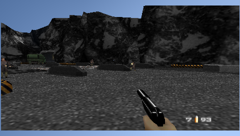

# GoldenEye 007 — abertura e primeira missão

## Problema reproduzido em 17/10/2026

No PSP, o usuário relatou quase um minuto de tela preta após a intro. A tela
Select File apareceu depois, sem travamento permanente. O PSPLink confirmou
`No exception occurred`. A sessão física foi encerrada e o aparelho liberado
para outro projeto; a investigação seguinte usa somente PPSSPPHeadless.

A ROM do cartão e a cópia local foram comparadas byte a byte por SHA-256:
`33d4609661bd207d22146463e64edbcc5cc9a21668f4f8e450642d2a2f6d2de8`,
12 MiB, ID Daedalus `d150bcdca31afd09-45`, GoldenEye 007 (U) [!]. Não é
incluída no repositório ou no pacote.

A build `6ac6136` e a anterior `4b19f1e` mostraram o mesmo intervalo escuro de
aproximadamente 40 segundos no primeiro roteiro. Logo, as correções recentes
de projeção e recorte do LEGO não introduziram a demora.

## Correção

GoldenEye acessa código da ROM pelo mapeamento TLB `0x7f`. O atalho herdado em
`Memory_Tlb_Hack` só é instalado quando a ROM tem endereço fixo. O padrão
File Cache mantinha esse caminho indisponível, com acesso mais caro durante
a emulação. A comparação controlada com ROM inteira em RAM apontou uma melhora
grande antes de alterar o núcleo.

A build agora prefere um buffer fixo para o cartucho GE de 12 MiB nos PSPs
com RAM ampliada. Usa o heap de ROM de 16 MiB já reservado, sem aumentar sua
reserva total. Se a alocação falhar, volta ao cache de arquivo. PSP-1000 e
imagens de outros tamanhos continuam com a política anterior. O caso validado
é a ROM americana acima; não é uma certificação das demais revisões ou hacks.

O carregamento também passa a falhar se uma leitura de bloco não terminar,
em vez de iniciar uma ROM parcialmente lida. Os demais jogos mantêm a escolha
de cache/buffer das preferências.

## Evidências sintéticas

O roteiro `tests/headless/goldeneye-dam.json` reconhece a inscrição Select File
por comparação de imagem antes de enviar os próximos comandos. Confere o
buffer fixo no log, seleciona uma partida e alcança Dam em primeira pessoa.
Também envia movimento e salva capturas antes/depois.

Na build final, Select File foi reconhecido 33,3 segundos após iniciar o EBOOT,
incluindo a navegação Frog e a intro, com dois comandos Start. O maior trecho
escuro amostrado durante a transição foi de 1,5 segundo, com amostras a cada
0,5 segundo. A espera por imagem começou logo após o segundo Start e durou
22,5 segundos; esse período também inclui animação visível da intro.

A build anterior recebeu os mesmos inputs e não encontrou Select File até
125,6 segundos desde o boot (100 segundos na espera por imagem, iniciada após
um intervalo fixo de 15 segundos). O maior trecho escuro observado nessa janela
foi de 28 segundos. Este roteiro tem inputs diferentes do primeiro experimento
de 40 segundos; não misturar essas medidas.

O tempo é medido no relógio do PSP emulado a 333 MHz, não em FPS N64 nem em
segundos medidos no aparelho. Transições curtas escuras do jogo continuam:
a correção não oculta o framebuffer com uma tela de carregamento durante a
partida. Audio Disabled foi usado para isolar a abertura; o áudio e a cadência
física não são aprovados por esse teste.

Também foi exercitado o fallback com uma cópia local sintética ampliada para
32 MiB: a tentativa não cabe no heap de ROM, o log confirma File Cache e a
execução continua. Isso verifica o tratamento de alocação, não compatibilidade
com uma ROM modificada.

Evidências locais: `dist/headless/goldeneye-verified-dam/`,
`dist/headless/goldeneye-measured-baseline/`, `dist/headless/goldeneye-final-gate/`
e `dist/headless/loader-allocation-fallback/`.

Ainda falta confirmar esta revisão no PSP físico e testar outras missões,
saves de longo prazo e finalização do jogo. A chegada a Dam não comprova que
GoldenEye inteiro pode ser concluído sem outros defeitos.
