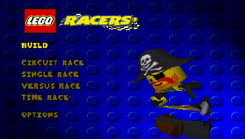
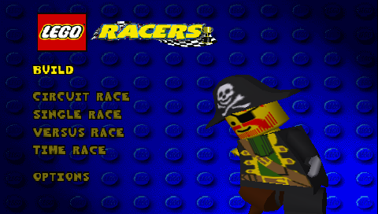
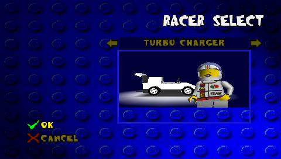
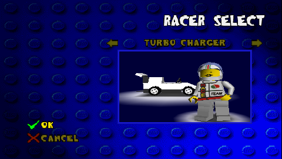

# LEGO Racers — diagnóstico e correções

## Estado em 17/10/2026

Dois defeitos gráficos herdados do renderizador PSP do Daedalus foram corrigidos
e reproduzidos em testes automatizados no PPSSPPHeadless. Não vieram da interface
FrogN64. A confirmação desta build no PSP físico ainda está pendente.

A ROM local fornecida pelo usuário é LEGO Racers (U) [!], ID
`ea406a09100abe8a-45`, SHA-256
`211983265868158281d16e5ba54d12f478da5ced47d34af35fb555b9a7ad51ba`.
Não é distribuída no Git ou no ZIP. O ambiente e os roteiros estão em
[HEADLESS.md](HEADLESS.md).

## Torsos e partes dos modelos

O N64 preserva a posição projetada de um vértice já carregado, mesmo após mudar
a matriz de projeção. LEGO Racers usa isso para montar partes articuladas dos
personagens. O caminho PSP reutilizava XYZ calculados sob uma projeção anterior,
aplicando depois a matriz mais recente ao lote inteiro. Os triângulos existiam,
mas eram deslocados ou deformados.

`VertexProjectionCache` registra a projeção de cada vértice e reexpressa apenas
os antigos no espaço da matriz atual, preservando sua posição projetada. A inversa
é calculada sob demanda uma vez por projeção. Este caminho é habilitado somente
para LEGO Racers no PSP.

Antes:

Depois:

A comparação usa o mesmo EBOOT de diagnóstico, alternando apenas a flag que
desliga a correção. Os testes matemáticos verificam triângulos com projeções
misturadas, posição e profundidade, W e interpolação para mudanças afins,
ausência de erro acumulado, cópia/recarga e reset do cache. Passaram no host com
ASan/UBSan e como código MIPS no JIT e interpretador PSP do PPSSPP.

As capturas também mostram torsos completos na seleção de pilotos e modelos
dos adversários na largada. Isso não comprova todas as pistas, personagens ou
o desaparecimento completo de karts relatado no aparelho.

## Pernas cortadas nas prévias

Após recuperar os torsos, o usuário identificou outro defeito: os pés sumiam
antes da borda inferior do quadro azul. `BaseRenderer::SetScissor` invertia Y
como no OpenGL, embora a GU do PSP use a origem no canto superior esquerdo.
A correção mantém essa inversão somente no backend OpenGL.

Antes:

Depois:

O quadro agora é preenchido até sua borda inferior, incluindo as pernas e a
plataforma. A assinatura e a implementação do SDK fixado foram verificadas:
`sceGuScissor` recebe x, y, largura e altura. Referência primária:
[PSPSDK sceGuScissor](https://github.com/pspdev/pspsdk/blob/master/src/gu/sceGuScissor.c).

## Áudio e limites

No teste físico anterior, o usuário confirmou navegador, jogo e pausa, depois
relatou estalos tanto em Sync quanto em Async. A fila herdada tinha perda de
amostras, primeira amostra não escrita e bloqueio com pacotes maiores que sua
capacidade. Esses defeitos foram corrigidos e os testes nativos/MIPS com WAV
sintético passaram. Isso não demonstra a eliminação de todos os estalos do jogo.

Os testes atuais exercitam Audio Sync até a corrida. Async/Media Engine,
cadência real a 333 MHz e melhora perceptível exigem a fase física posterior.
A sessão PSPLink foi encerrada a pedido do usuário para outro projeto; nenhum
acesso ao aparelho foi feito durante esta investigação sintética.

As primeiras tentativas sem HLE, sem otimizações N64, sem VFPU e com clipping,
blend, alpha ou profundidade desligados não recuperaram o torso. Não foram
adotadas como correção. O interpretador N64 não alcançou a mesma cena e não
constitui comparação visual válida; o interpretador PSP validou os testes MIPS.
